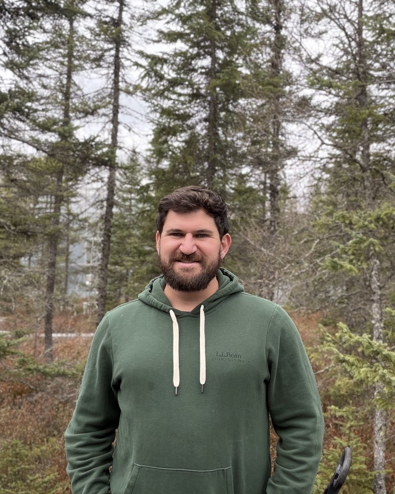

::: {.home-grid}
::: {}
{.home-photo .nolightbox fig-alt="Jon Gewirtzman"}
:::
::: {}
I'm an ecosystem ecologist and biogeochemist. I study how ecosystems cycle carbon, nutrients, and greenhouse gases, and how those cycles respond to environmental change. I'm especially interested in the plants and microbes that drive these processes, from the communities living inside trees to the soils, wetlands, and forests they're part of.

I work mostly in forests and wetlands, using field measurements, experiments, molecular tools, and sensors I help build. I'm also interested in how this understanding can inform ecosystem management and climate solutions.

I'm a [Stanford Science Fellow](https://stanfordsciencefellows.stanford.edu/) in the [Department of Earth System Science](https://earthsystemscience.stanford.edu/), working with the [Jackson Lab](https://jacksonlab.stanford.edu/). I completed my PhD at the [Yale School of the Environment](https://environment.yale.edu/) in 2026, and have been a research fellow at [Harvard Forest](https://harvardforest.fas.harvard.edu/) and an LTER Synthesis Fellow with [NCEAS](https://nceas.ucsb.edu/).

::: {.links-row}
[Google Scholar](https://scholar.google.com/citations?hl=en&user=1uVeNjEAAAAJ) · [GitHub](https://github.com/jgewirtzman) · [Bluesky](https://bsky.app/profile/jgewirtzman.bsky.social) · [Email](mailto:jgewirtz@stanford.edu)
:::
:::
:::
