I study how ecosystems cycle carbon, nutrients, and greenhouse gases, and how those cycles respond to rapid environmental change. Across the projects below, I ask which species and communities drive these cycles, how processes that pull in opposite directions balance out, and how what we learn can help manage land and address climate change.

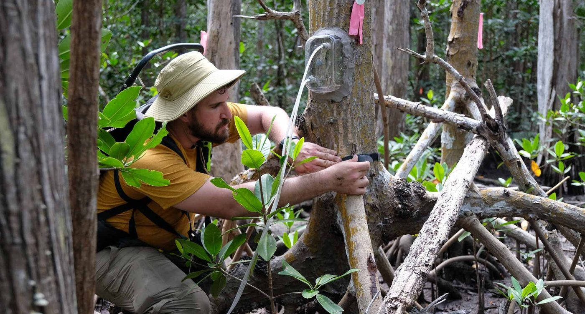{.page-photo .nolightbox fig-alt="Measuring gas fluxes from a mangrove stem in the Everglades"}

<nav class="jump" aria-label="Research sections">

<a href="#microbiomes-of-living-trees">Microbiomes</a><a href="#greenhouse-gas-biogeochemistry">Greenhouse gases</a><a href="#forest-ecosystem-ecology">Forests</a><a href="#measurement-scaling">Measurement</a><a href="#ecosystems-climate-solutions">Climate solutions</a>

<button type="button" class="expand-all" aria-expanded="false">Expand all</button>
</nav>

<h2 class="sec-title">Microbiomes of Living Trees</h2>

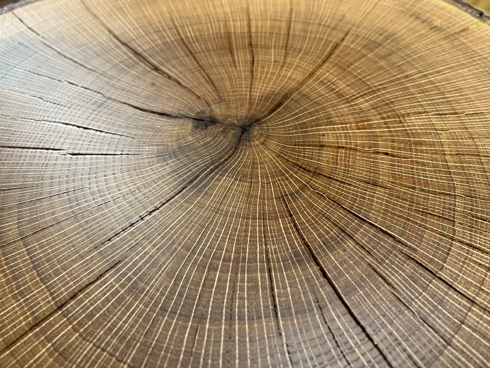{.research-photo group="microbiomes" fig-alt="Cross-section of a tree showing growth rings"}

A single tree holds roughly a trillion microbial cells in its wood, a community that was almost unstudied until recently. I study which microbes live inside trees, how those communities form, and what they do, including their roles in cycling carbon and nitrogen.

ProjectsHide projects

Root and leaf microbiomes have been studied extensively, but until recently very little was known about the microbes living inside trees. I helped develop [**methods**](https://doi.org/10.1111/2041-210X.14311) for extracting, sequencing, and quantifying microbial DNA from wood, and used them to characterize bacterial, archaeal, and fungal communities across tissues and species of temperate trees.

Heartwood and sapwood host distinct communities, different from those in soils, leaves, and roots, and consistent within tree species. Anoxic heartwood is enriched in anaerobes, including methane-producing archaea and nitrogen fixers; sapwood and bark host aerobes, including methane oxidizers. We published this work in [**Nature**](https://doi.org/10.1038/s41586-025-09316-0) in 2025; it was covered in [Science](https://www.science.org/content/article/more-1-trillion-microbes-live-inside-average-tree-trunk) and the [New York Times](https://www.nytimes.com/2025/08/27/science/biology-trees-microbiomes.html).

Current work asks how these communities assemble and how they vary among host species, tissues, and environments. I am sampling trees in tropical forests in [Panama](https://stri.si.edu/) and Brazil and at the [SPRUCE](https://mnspruce.ornl.gov/) warming experiment in Minnesota to compare with temperate forests. I am also interested in what these microbes do: nitrogen fixation, decay, and the production and consumption of greenhouse gases.

::: {.gallery}
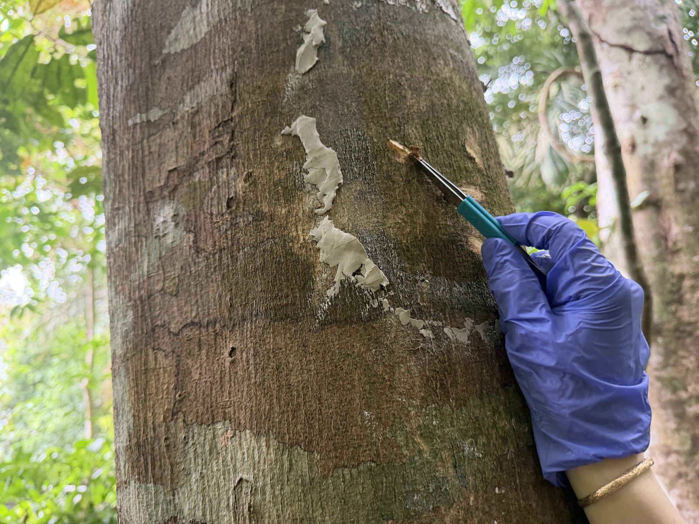{group="microbiomes" fig-alt="Sampling bark microbes from a tree trunk with a gloved hand" loading="lazy"}

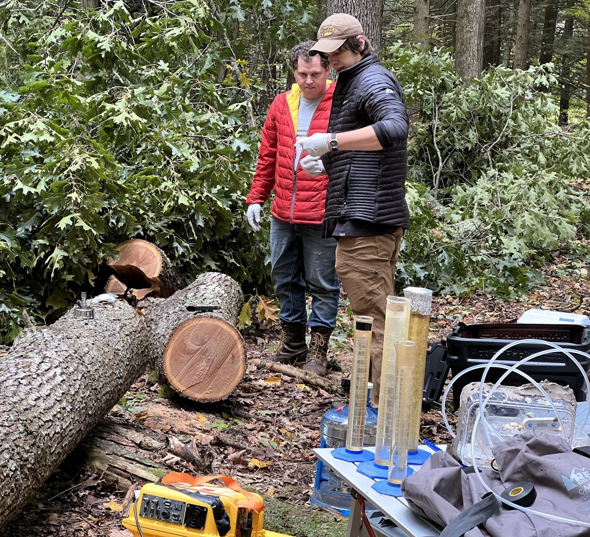{group="microbiomes" fig-alt="Field DNA-extraction setup beside a freshly cut log" loading="lazy"}

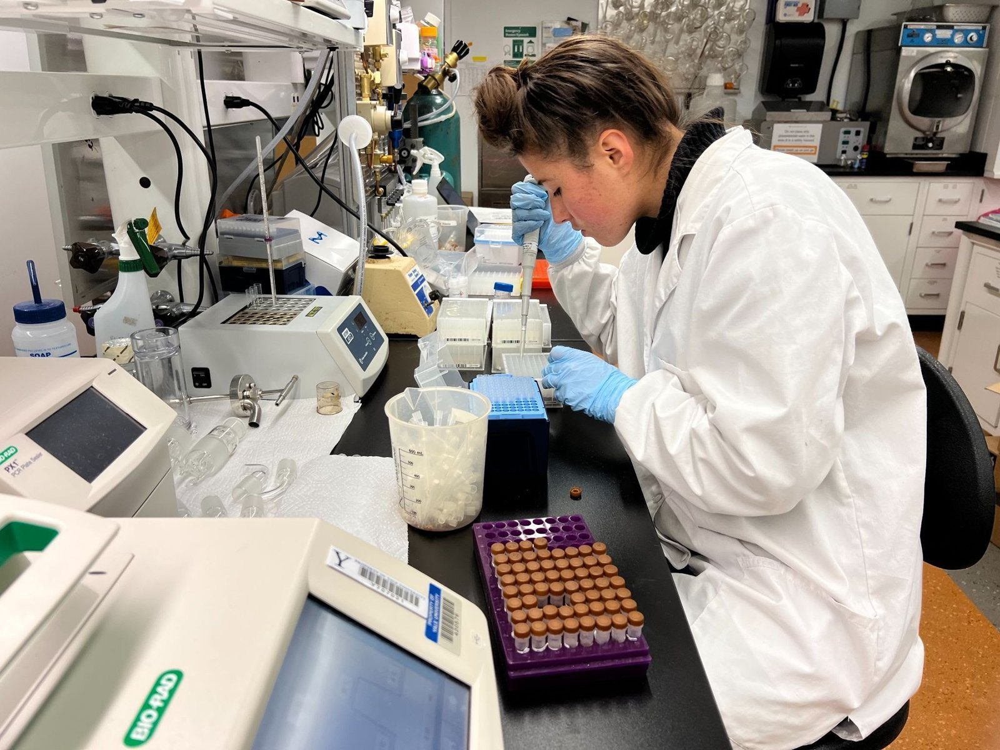{group="microbiomes" fig-alt="Preparing wood samples for DNA extraction in the lab" loading="lazy"}

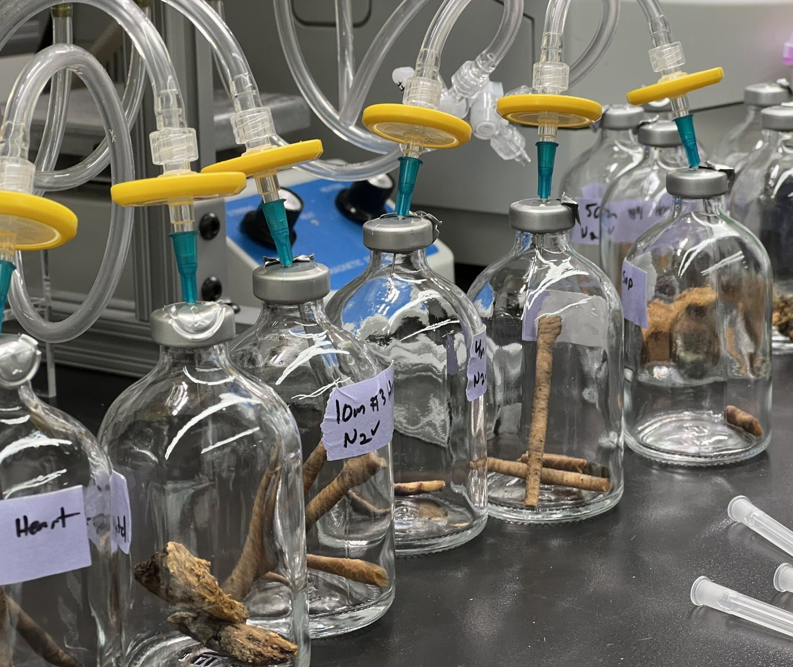{group="microbiomes" fig-alt="Wood cores incubating in sealed glass jars" loading="lazy"}

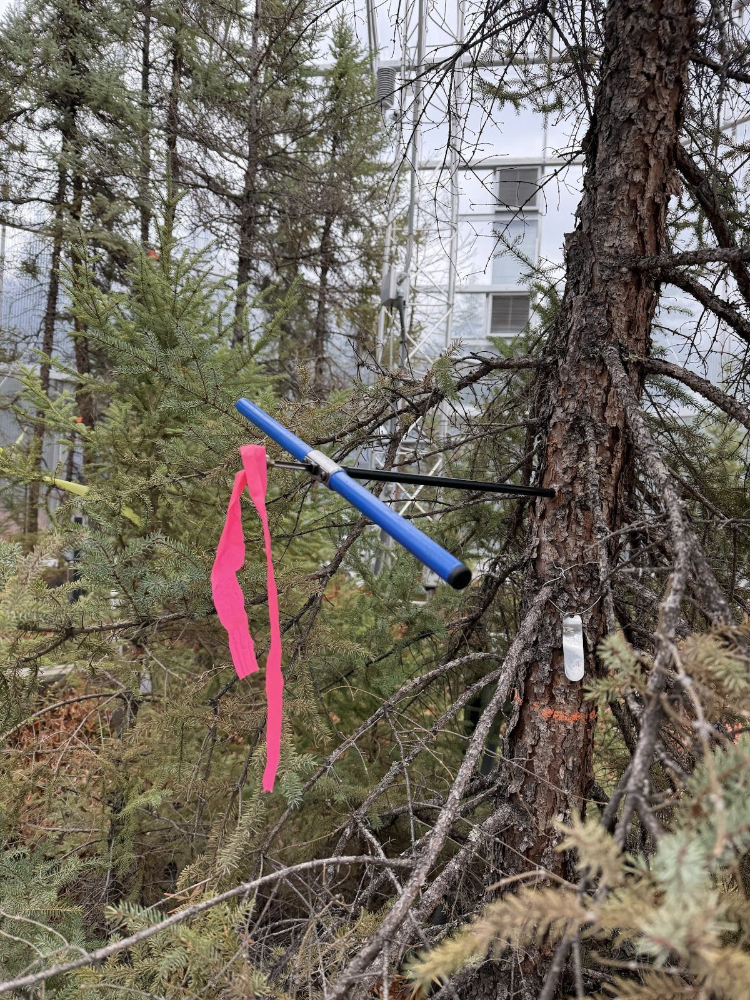{group="microbiomes" fig-alt="Flagged black spruce at the SPRUCE experiment in Minnesota" loading="lazy"}
:::

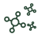<h2 class="sec-title">Greenhouse Gas Biogeochemistry</h2>

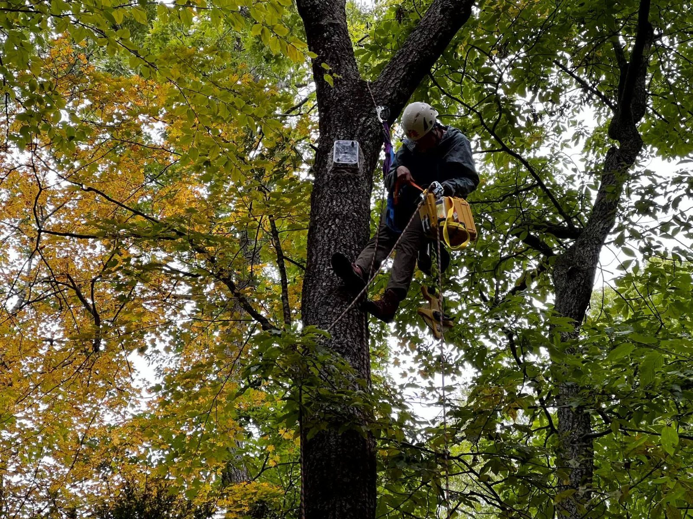{.research-photo group="biogeochemistry" fig-alt="Climber measuring gas exchange in a tree canopy"}

Land ecosystems both release and take up carbon dioxide, methane, and nitrous oxide, and these exchanges are among the largest uncertainties in projections of future climate. I measure them from the forest floor to the canopy, in ecosystems from tundra to temperate, boreal, and tropical forests, inland and coastal wetlands, and farms. I focus especially on trees, whose role in methane cycling was overlooked until recently.

ProjectsHide projects

Tree stems are a recently recognized and poorly constrained source and sink of methane. Trees can emit methane produced inside their wood or transported from soils, and can take it up through bark-dwelling microbes. In upland forests of New England, stem emissions partly offset soil uptake, species differ widely, and the balance of methane producers and consumers inside a tree helps explain its [**net exchange with the atmosphere**](https://doi.org/10.1101/2025.09.30.679632). At [Howland Forest](https://umaine.edu/howlandforest/) in Maine, stem emissions rise sharply above a [**soil moisture threshold**](https://doi.org/10.1007/s10533-025-01257-0). I am extending this work to tropical forests, where tree fluxes are largest and least measured, with campaigns at the [Mamirauá](https://mamiraua.org.br/) floodplain forest in Brazil combining stem and canopy measurements with microbial sampling.

I also study methane and CO~2~ budgets at the ecosystem scale. At [Harvard Forest](https://harvardforest.fas.harvard.edu/), I work on [**small forested wetlands**](https://doi.org/10.64898/2026.01.29.702553) that flood and drain seasonally, where methane production, oxidation, bubbling, and plant transport change with the water table. In the Everglades, as field survey lead for NASA's [**BlueFlux campaign**](https://doi.org/10.1088/1748-9326/acdae6), I led measurements from mangrove soils, stems, and surface waters across a gradient from hurricane-killed and hypersaline die-off sites to regenerating stands. These data support regional assessments of how [**water management and climate change**](https://doi.org/10.1073/pnas.2513685123) affect wetland greenhouse gas fluxes.

In agricultural systems, I measure greenhouse gas fluxes from soils, manure, and compost under conventional and regenerative management, with [Hudson Carbon](https://www.hudsoncarbon.com/) and [Churchtown Dairy](https://www.churchtowndairy.org/).

::: {.gallery}
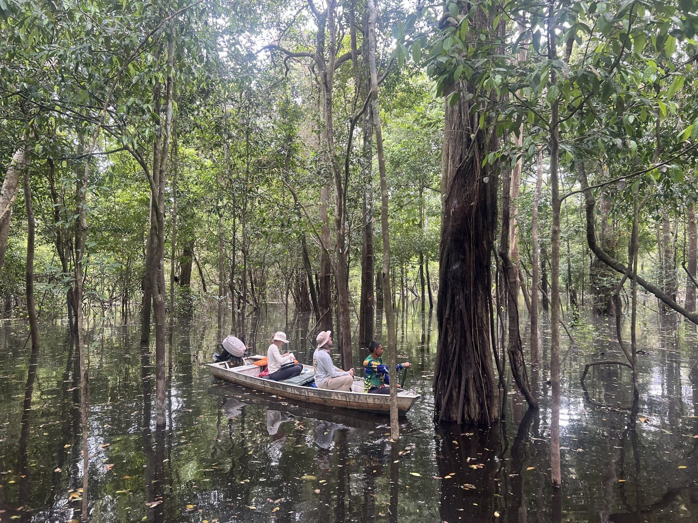{group="biogeochemistry" fig-alt="Canoeing through a flooded forest at Mamirauá, Brazil" loading="lazy"}

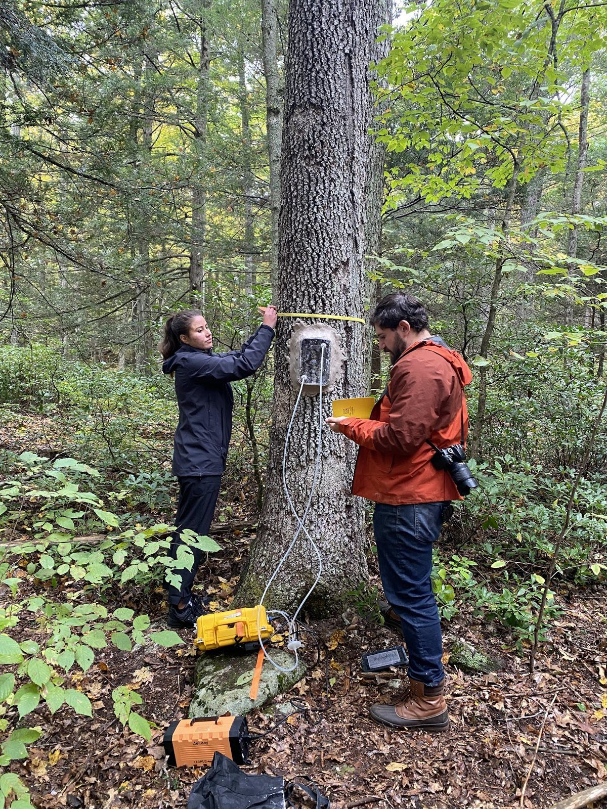{group="biogeochemistry" fig-alt="Two researchers measuring methane flux from a tree stem" loading="lazy"}

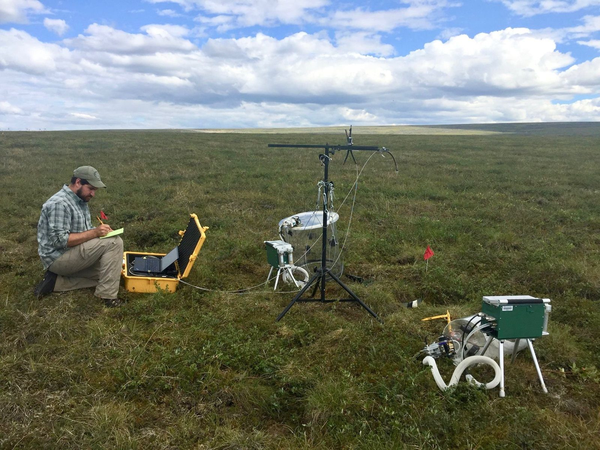{group="biogeochemistry" fig-alt="Flux chamber on the tundra at Toolik Field Station, Alaska" loading="lazy"}

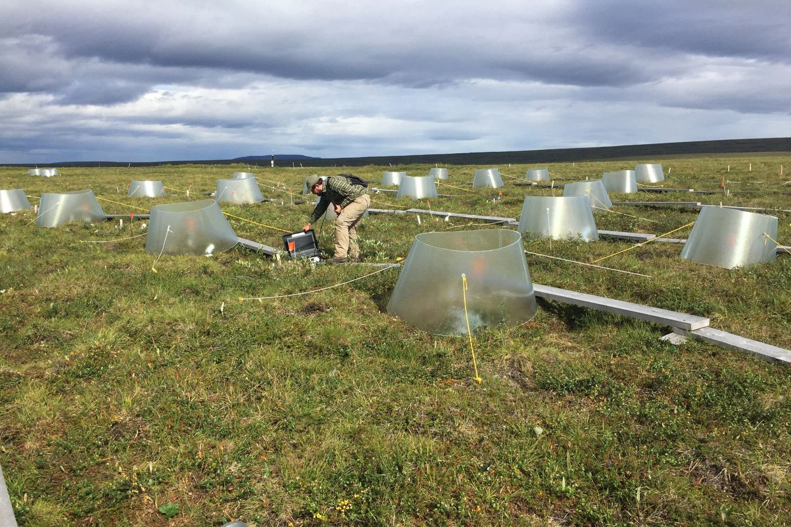{group="biogeochemistry" fig-alt="Array of chambers on tundra at Toolik Field Station" loading="lazy"}

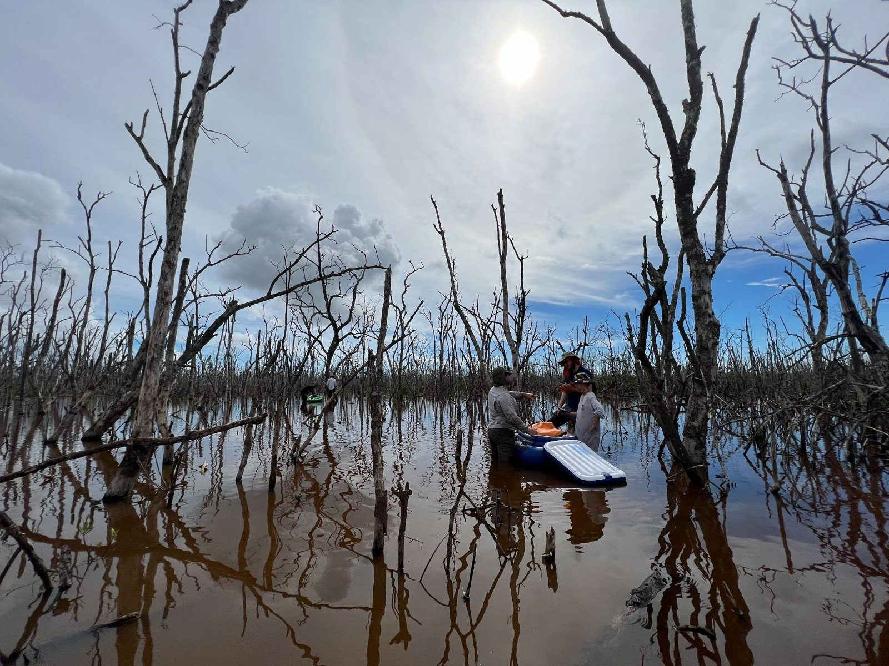{group="biogeochemistry" fig-alt="Boat among standing dead mangroves in the Everglades" loading="lazy"}

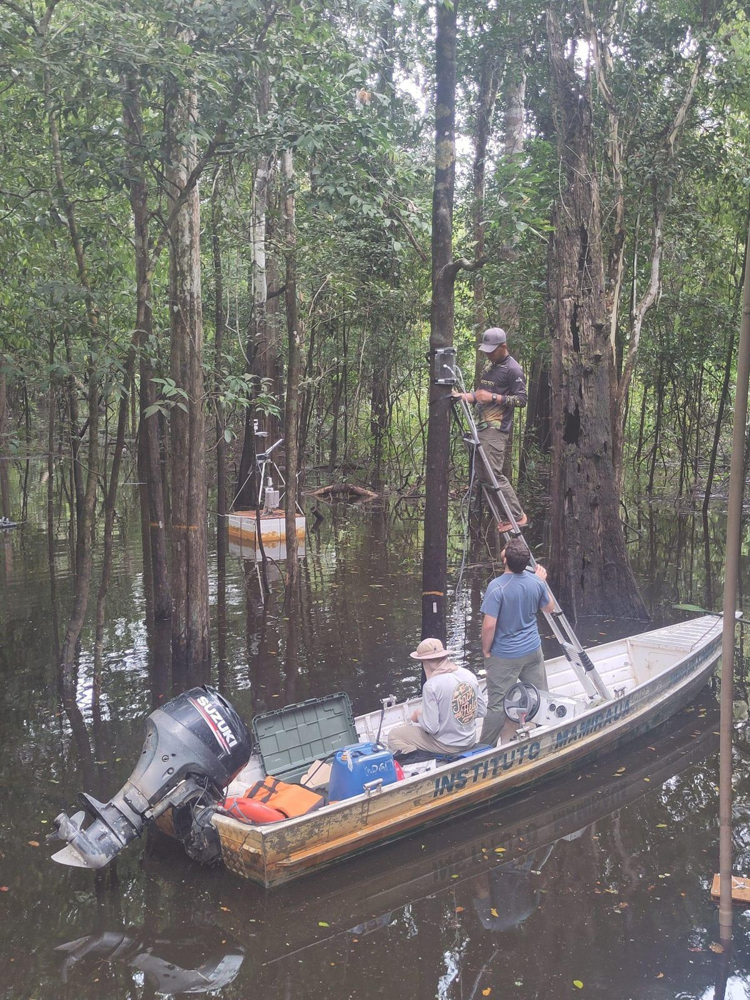{group="biogeochemistry" fig-alt="Ladder against a tree in a flooded forest at Mamirauá" loading="lazy"}

{group="biogeochemistry" fig-alt="Field team in life jackets on a boat" loading="lazy"}
:::

<h2 class="sec-title">Forest & Ecosystem Ecology</h2>

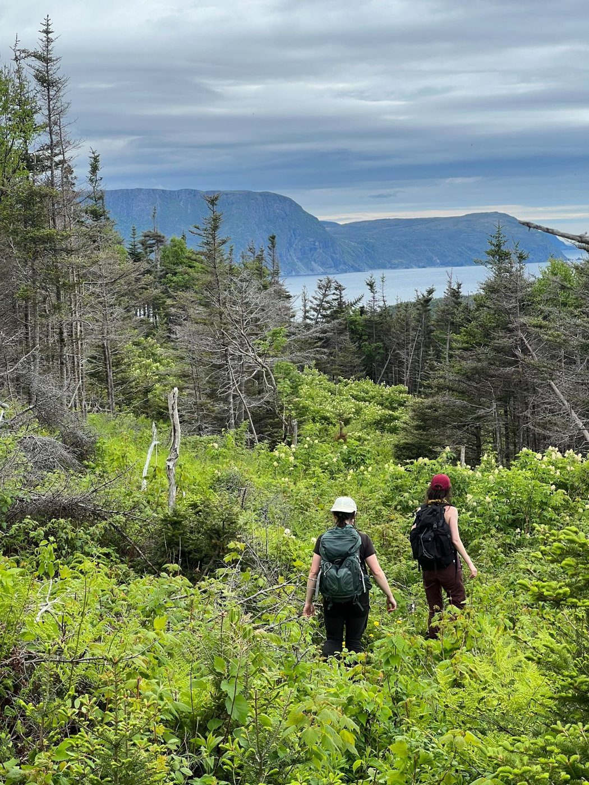{.research-photo group="forest" style="object-position: 50% 38%" fig-alt="Field team walking through a boreal valley in Newfoundland"}

Much of my forest work concerns the health of individual trees and how forests respond to disturbance: decay hidden inside living trees, novel pests and pathogens, extreme weather, and a changing climate.

ProjectsHide projects

Decay inside living trees is common but hard to see. Using sonic and electrical resistance tomography, I image [**internal decay**](https://doi.org/10.64898/2026.06.10.730433) without cutting trees down, to ask how widespread it is, where it concentrates, and what it means for carbon stocks and gas production. I also study [beech leaf disease](https://greatmountainforest.org/what-happens-to-the-american-beech/) in New England, including whether infected trees die by exhausting their carbohydrate reserves.

Bark and branches are habitat for microbes, epiphytes, and animals, and the interface across which trees exchange gases with the atmosphere, yet their total area is rarely measured. I've written about [**woody surface area**](https://doi.org/10.1111/gcb.70699) as an ecosystem property in its own right.

In Newfoundland, I collaborate on how moose browsing and canopy disturbance shape boreal forest regeneration and carbon storage. With Harvard Forest colleagues, I reviewed how [**extreme precipitation**](https://doi.org/10.1146/annurev-ecolsys-102723-042035) affects temperate forests during leaf-out, peak growth, and senescence. Earlier work followed change along gradients: [**Arctic sedges**](https://doi.org/10.1111/1365-2435.70367) under warming and drying, [**nitrogen cycling**](https://doi.org/10.1111/gcb.16611) from city to countryside, and [**silicon and carbon**](https://doi.org/10.1029/2019GB006308) moving from soils to rivers.

::: {.gallery}
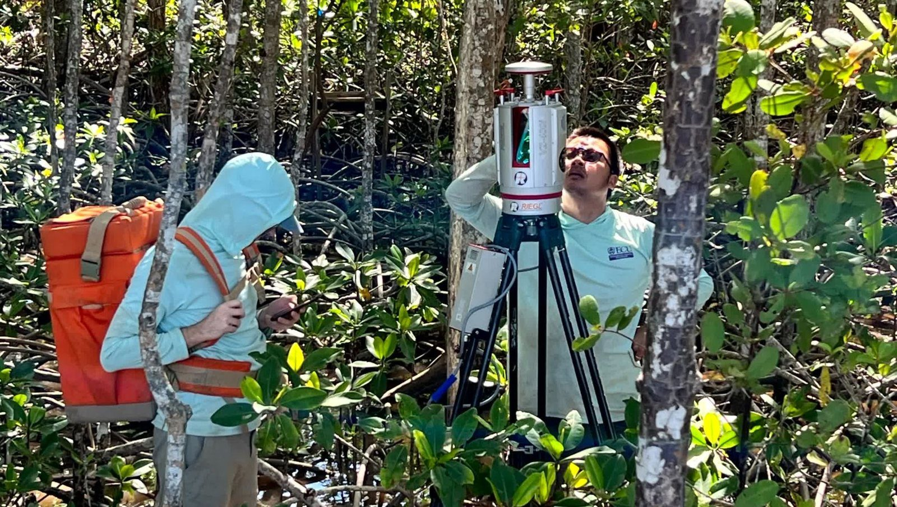{group="forest" fig-alt="Terrestrial laser scanning in a mangrove forest" loading="lazy"}

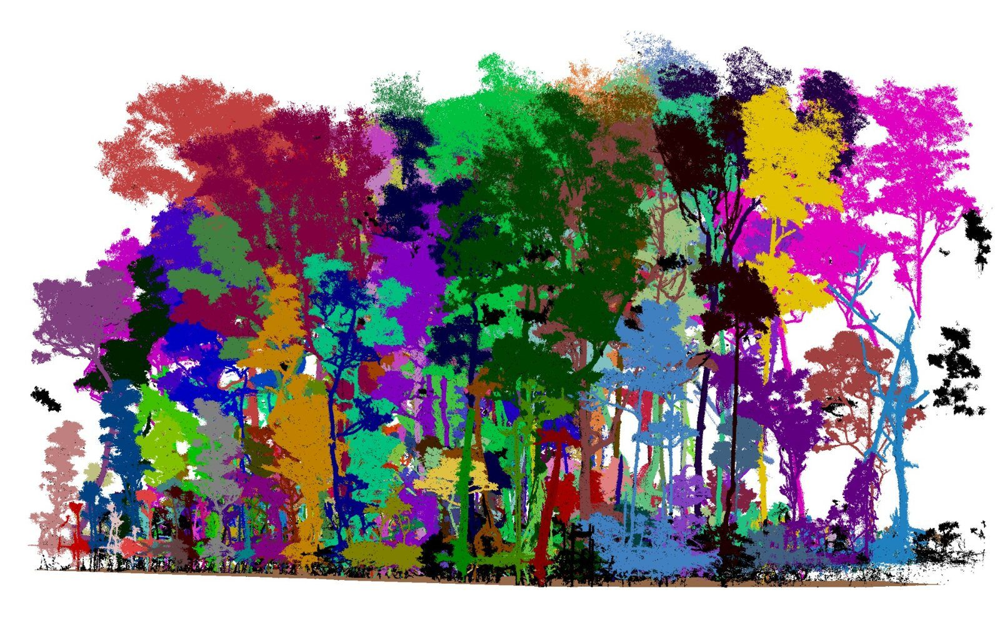{group="forest" fig-alt="Laser-scan point cloud of a forest plot with each tree in a different color" loading="lazy"}

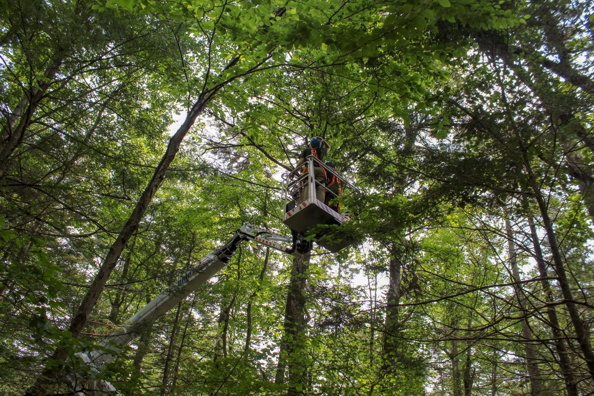{group="forest" fig-alt="Looking up into the canopy of a temperate forest" loading="lazy"}

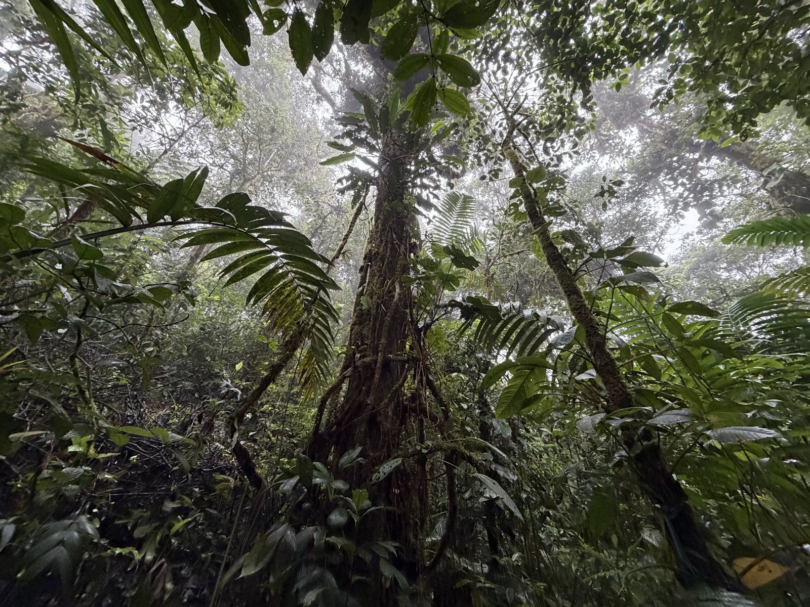{group="forest" fig-alt="Tropical forest canopy seen from below" loading="lazy"}

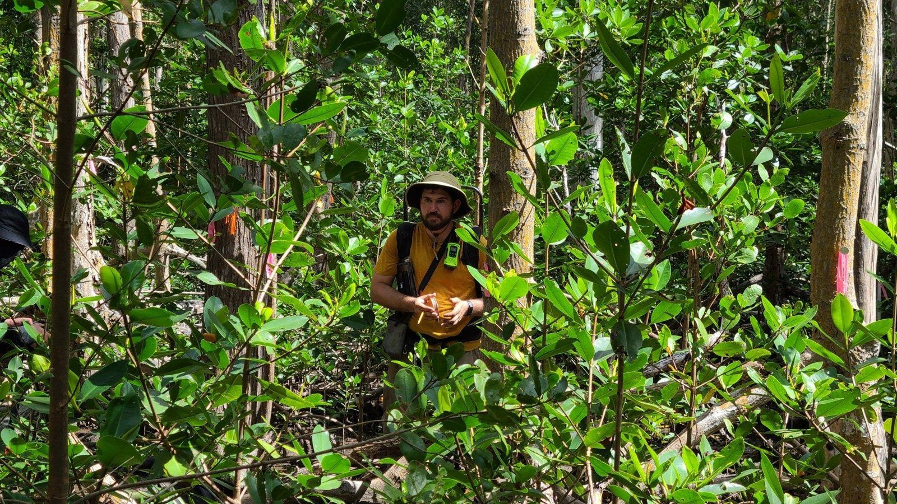{group="forest" fig-alt="Sampling in a mangrove stand" loading="lazy"}

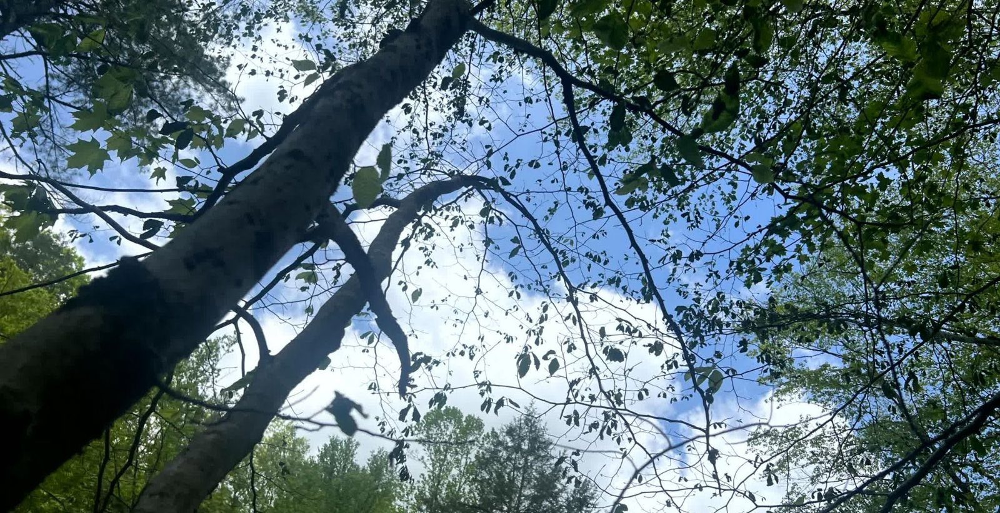{group="forest" fig-alt="Tree crowns against the sky" loading="lazy"}

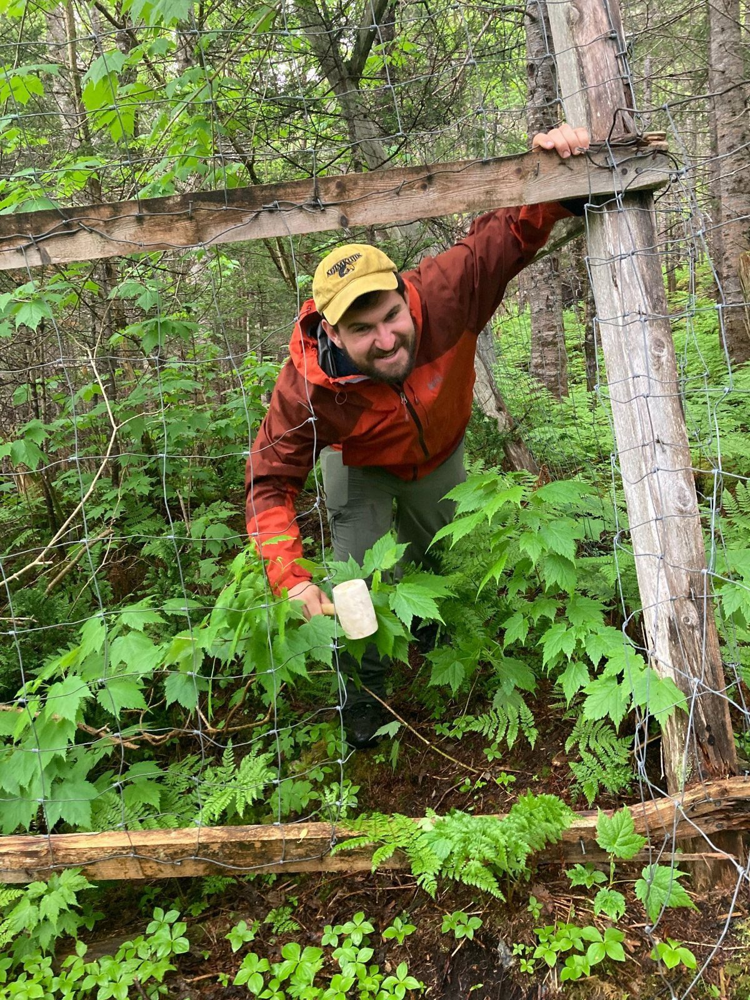{group="forest" fig-alt="Jon on a moose exclosure fence in Newfoundland" loading="lazy"}

:::

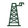<h2 class="sec-title">Measurement & Scaling</h2>

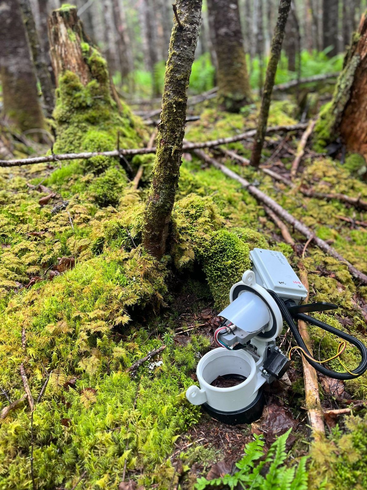{.research-photo group="measurement" style="object-position: 50% 80%" fig-alt="Fluxbot autonomous soil flux chamber on a mossy forest floor"}

Most greenhouse gas measurements rely on expensive instruments at a few fixed sites. I build cheaper, automated sensors so fluxes can be measured in more places and more often, and work on scaling those measurements from single stems to whole forests.

ProjectsHide projects

With collaborators at UC Santa Barbara and Yale, I helped develop [**Fluxbots**](https://dl.acm.org/doi/10.1145/3674829.3675063), open-source autonomous chambers that run in arrays for [**continuous soil CO~2~ monitoring**](https://doi.org/10.31223/X5TB3F) across a landscape, and calibrated the [**low-cost sensor**](https://doi.org/10.3390/s24175675) they depend on. For methane and nitrous oxide, I extended the design into automated chambers that connect to precision analyzers and mount on stems, in canopies, and over water. These are running at Howland Forest. I also work on how small fluxes near detection limits should be processed and reported.

Scaling stem fluxes to a forest requires knowing how much surface there is and how fluxes change with height. I measure fluxes at height with professional climbers, use terrestrial laser scanning to quantify woody surface area, and compare chamber-based estimates with tower measurements through the [**Flux Gradient Project**](https://lternet.edu/working-groups/the-flux-gradient-project/) at [NEON](https://www.neonscience.org/) sites and a [**global synthesis**](https://www.creaf.cat/en/research/synthesis-actions/methane-fluxes-tree-stems) of tree stem methane data.

::: {.gallery}
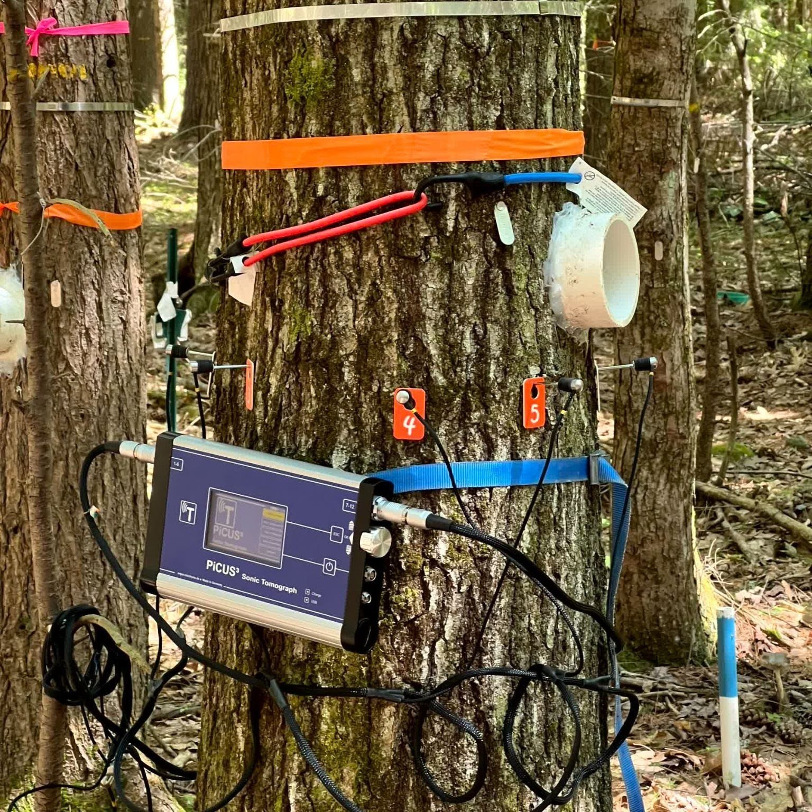{group="measurement" fig-alt="Automated chambers and analyzer mounted on a tree stem" loading="lazy"}

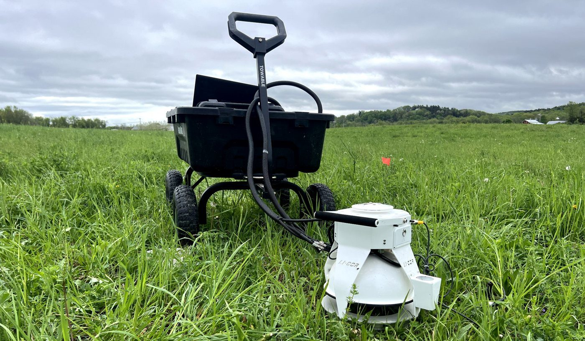{group="measurement" fig-alt="Soil flux chamber and analyzer on a cart in a meadow" loading="lazy"}

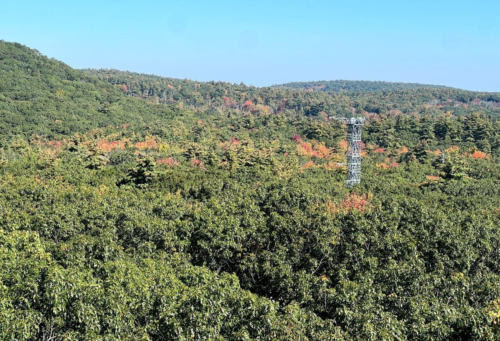{group="measurement" fig-alt="Flux tower rising above an autumn forest canopy" loading="lazy"}

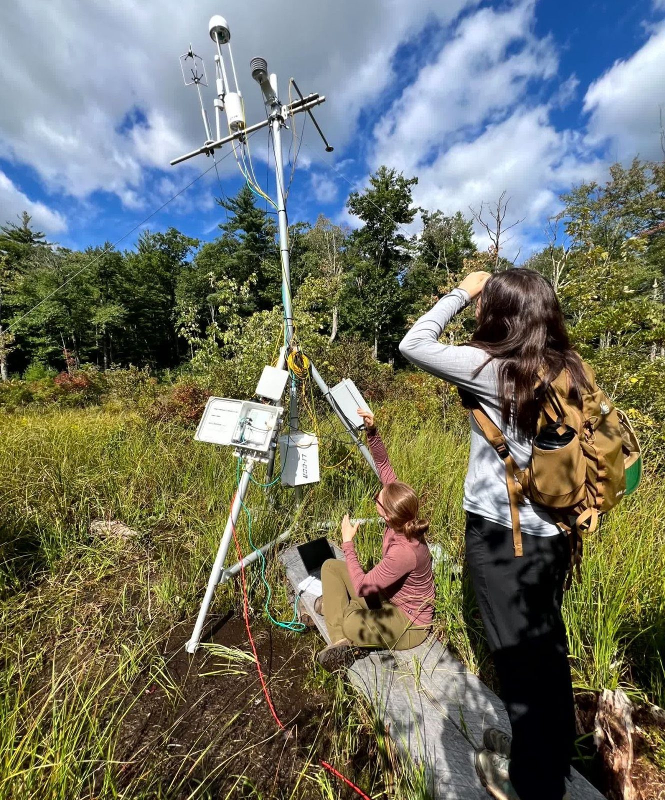{group="measurement" fig-alt="Installing instruments on a flux tower" loading="lazy"}

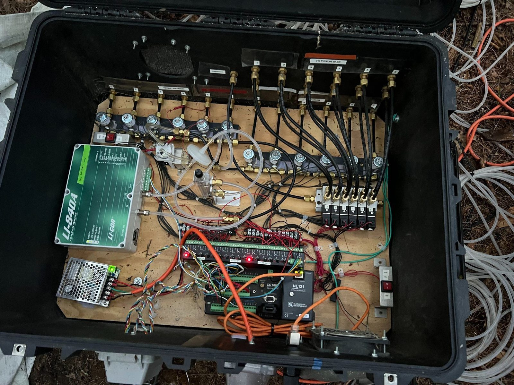{group="measurement" fig-alt="Electronics inside a Fluxbot controller enclosure" loading="lazy"}

{group="measurement" fig-alt="Field team on a tower platform above the forest canopy" loading="lazy"}

:::

<h2 class="sec-title">Ecosystems & Climate Solutions</h2>

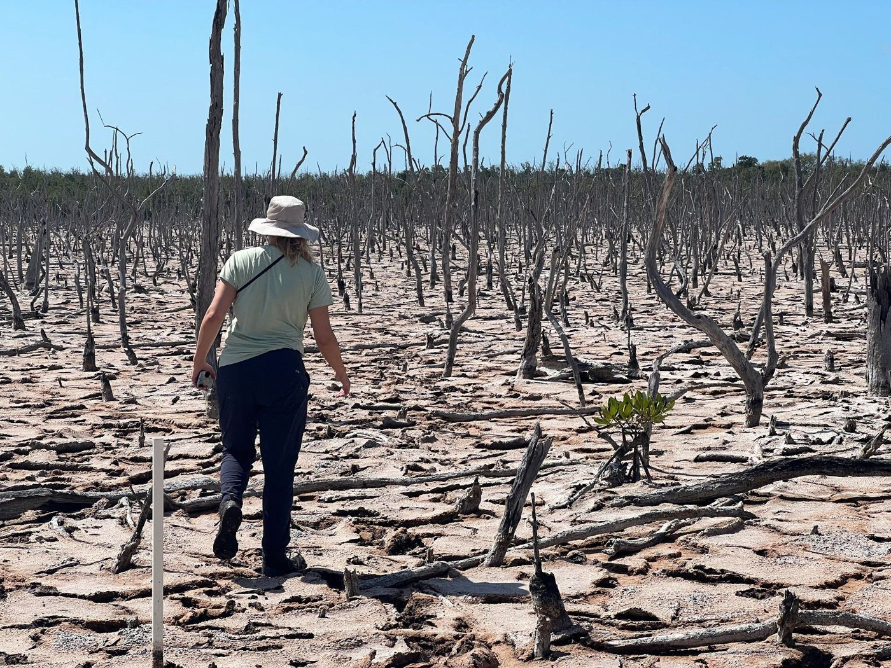{.research-photo group="climate" fig-alt="Standing dead mangroves in a hypersaline ghost forest"}

Forests, wetlands, and farms are increasingly managed and credited for climate benefits, but the accounting is usually done in carbon alone. I measure their full greenhouse gas balance, and study whether ecosystems could be managed to remove more methane.

ProjectsHide projects

Methane and nitrous oxide can offset part of the carbon an ecosystem takes up, and restoration, water management, and land use can shift the balance either way. My work in the Everglades and on dairy farms measures these trade-offs directly. With the [Yale Applied Science Synthesis Program](https://synthesis.yale.edu/), I've examined [**what makes a high-quality forest carbon credit**](https://yff.yale.edu/sites/default/files/yffreview/yfffeb2024online_3.pdf).

Ecosystems also remove methane from the atmosphere, through upland soils and methane-oxidizing microbes on bark and wood. Whether that uptake can be protected or enhanced is an open question. Through [CarbonFix](https://carbonfix.org/)'s [**Boreal Biosequester**](https://carbonfix.org/projects/boreal-biosequester/) effort, I'm helping assess under what conditions boreal forests might be managed as stronger methane sinks.

Before graduate school, I worked on international climate finance and [**loss and damage**](https://doi.org/10.1080/14693062.2018.1450724) under the UNFCCC.

::: {.gallery}
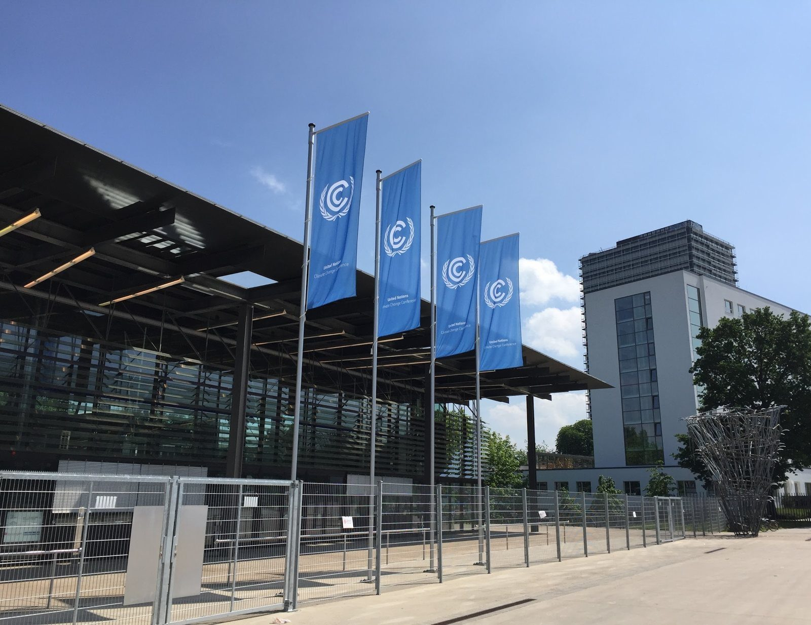{group="climate" fig-alt="UN Climate Change headquarters in Bonn, Germany" loading="lazy"}

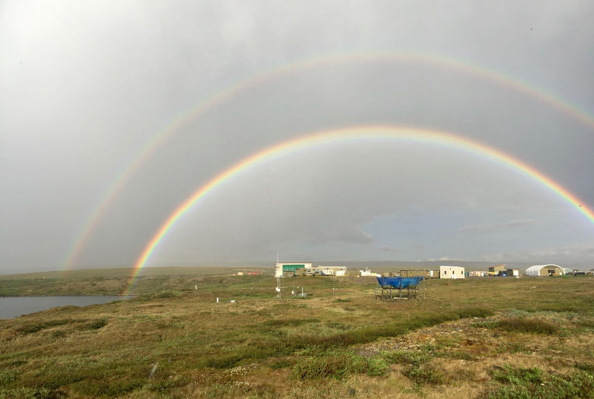{group="climate" fig-alt="Rainbow over the tundra at Toolik Field Station, Alaska" loading="lazy"}

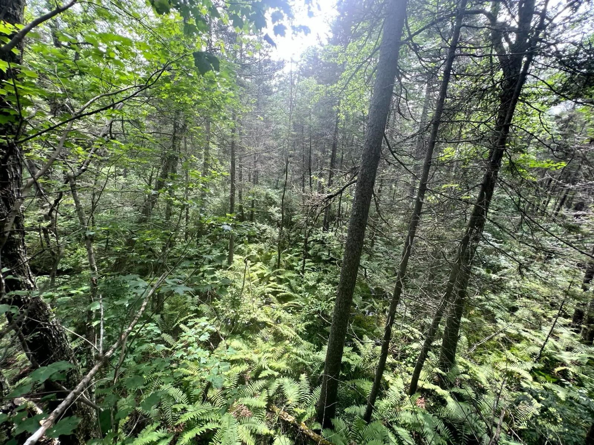{group="climate" fig-alt="Interior of a spruce-fir forest" loading="lazy"}
:::

