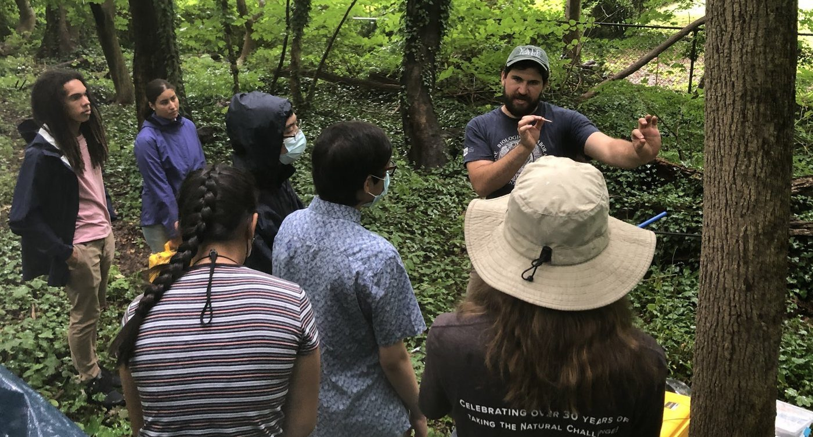
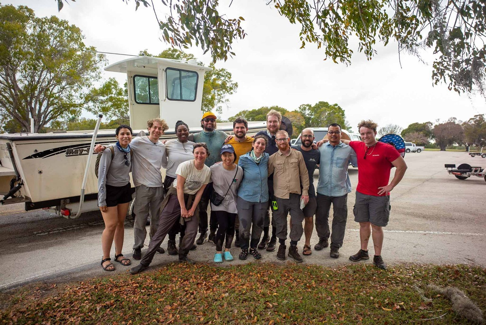
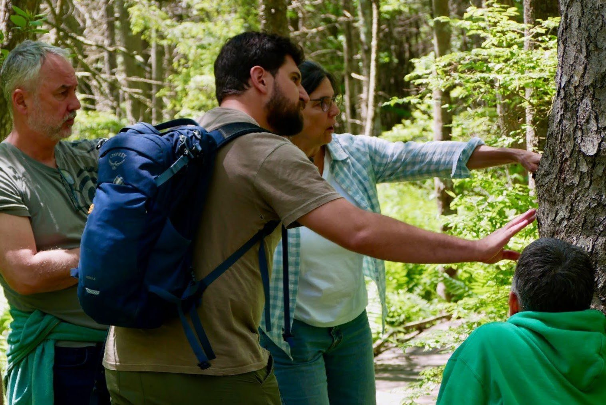
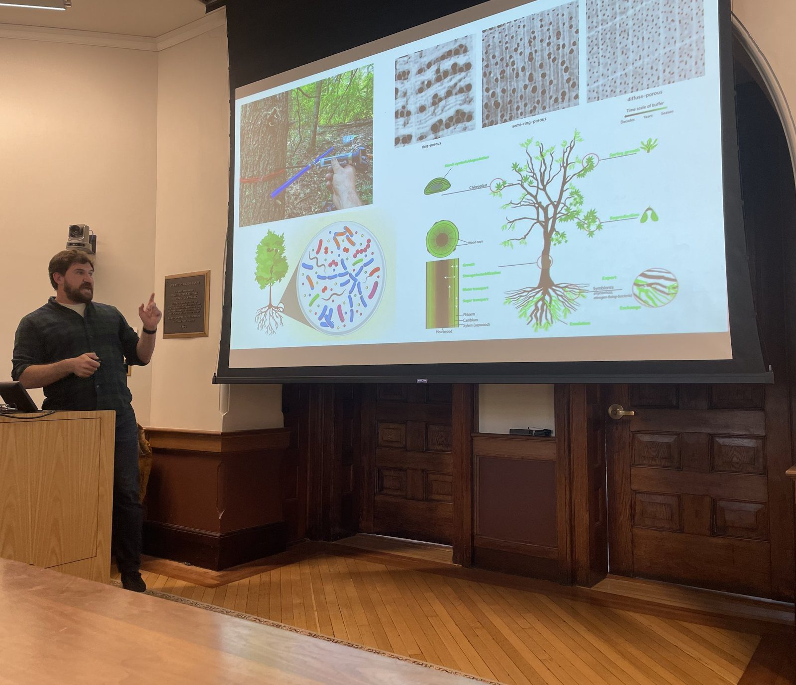
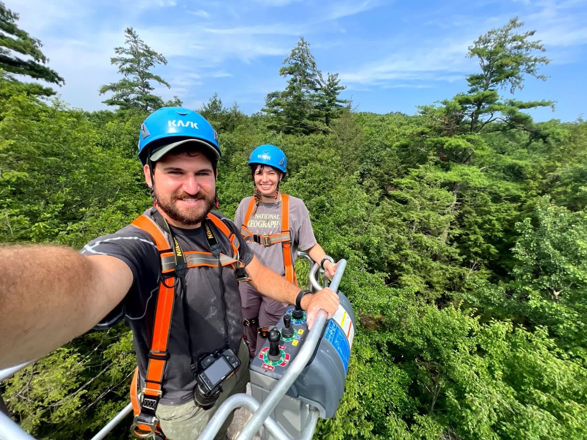
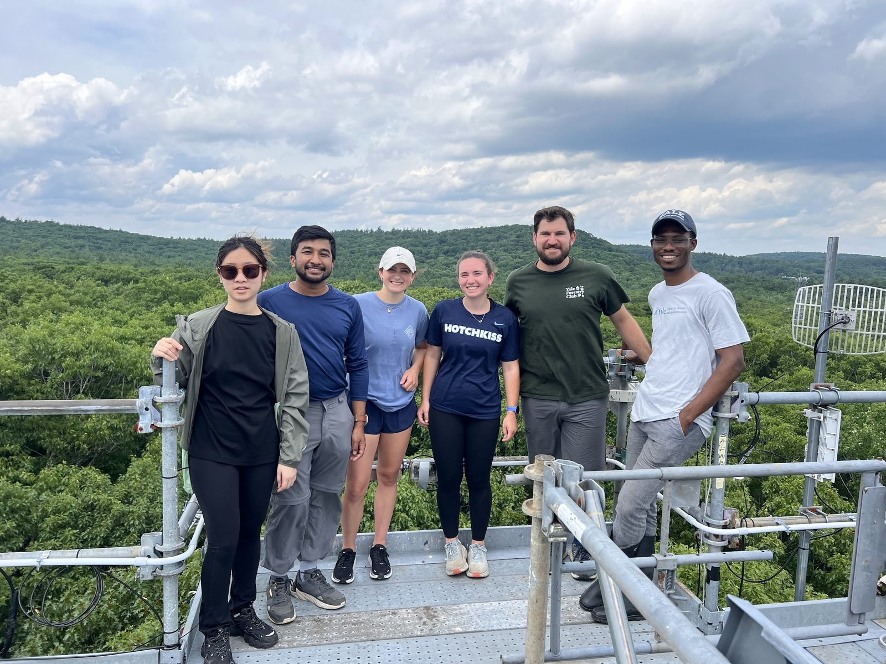
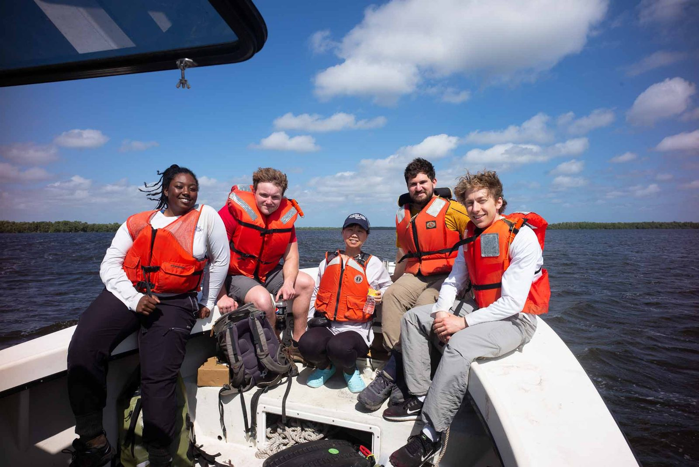
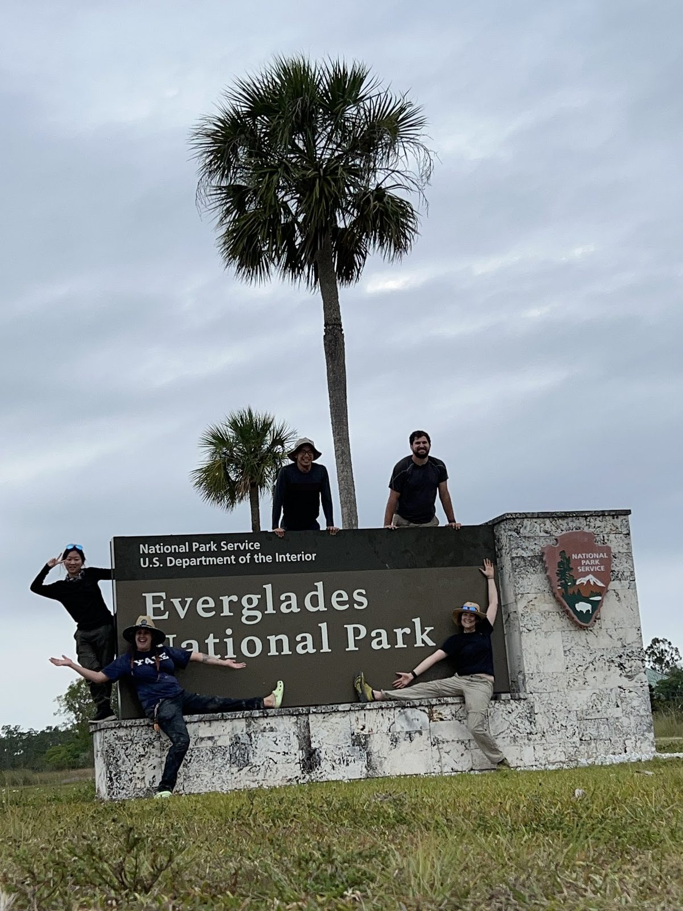

{.page-photo .nolightbox fig-alt="Students in the field"}

## Teaching

I designed and taught Plant Ecology (lecture and lab) at [Connecticut College](https://www.conncoll.edu/academics/majors-departments-programs/departments/botany/) in 2024, and was a teaching fellow for six courses at Yale, including Forest Dynamics, Methane in Global Climate Disruption, Environmental Data Science in R, and Science for Policy and Practice. I hold a [Certificate of College Teaching Preparation](https://poorvucenter.yale.edu/certificate-college-teaching-preparation) from Yale's Poorvu Center. My teaching relies on field work, real data, and student-designed projects. Materials for teaching R to ecologists are on [GitHub](https://github.com/jgewirtzman/intro_r_for_ecology).

## Mentoring

I've supervised more than forty undergraduate and high school researchers through the [Harvard Forest REU](https://harvardforest.fas.harvard.edu/other-tags/reu), the Yale-Myers [Ingalls Field Ecology Program](https://forests.yale.edu/students/ingalls-field-ecology-program), Yale senior theses and independent studies, and programs at Boston University, and have mentored master's theses at Yale. Several mentees have co-authored papers, including our Nature paper. I now also serve on doctoral advisory committees. I aim to move students from close supervision toward independent projects, with regular feedback along the way, and to make field research accessible to people who haven't done it before.

Students and collaborators interested in this work are welcome to get in touch.

::: {.gallery}
{group="teaching" fig-alt="Field crew group photo" loading="lazy"}

{group="teaching" fig-alt="Explaining a measurement to students in the field" loading="lazy"}

{group="teaching" fig-alt="Lecturing on tree microbiomes in a lecture hall" loading="lazy"}

{group="teaching" fig-alt="Jon and a student in climbing harnesses on a canopy platform" loading="lazy"}

{group="teaching" fig-alt="Field team on a tower platform above the forest canopy" loading="lazy"}

{group="teaching" fig-alt="Field team in life jackets on a boat" loading="lazy"}

{group="teaching" fig-alt="Field team posing on the Everglades National Park sign" loading="lazy"}
:::

## Science communication

Our work on tree microbiomes was covered by [The New York Times](https://www.nytimes.com/2025/08/27/science/biology-trees-microbiomes.html), [Science](https://www.science.org/content/article/more-1-trillion-microbes-live-inside-average-tree-trunk), and [Scientific American](https://www.scientificamerican.com/article/scientists-map-microbiome-hidden-deep-inside-tree-trunks/), and I discussed it on the [Nature Podcast](https://www.youtube.com/watch?v=gSD4SluHtRE&t=586s) and public radio's [Living on Earth](https://www.loe.org/shows/segments.html?programID=26-P13-00039&segmentID=4). [Science Journal for Kids](https://www.sciencejournalforkids.org/articles/what-microorganisms-live-inside-wood/) adapted the study for middle and high school classrooms.

```{=html}
<figure class="audio">
<audio controls preload="none" src="https://loe.org/content/2026-09-25/LOE_260925_C2_Tree%20Bark%20Microbes%20and%20Climate.mp3"></audio>
<figcaption><a href="https://www.loe.org/shows/segments.html?programID=26-P13-00039&segmentID=4">Living on Earth</a>, "Tiny Microbes in Tree Bark," September 25, 2026 (8 min; transcript on their site)</figcaption>
</figure>
```

Other coverage and interviews:

- [The Boston Globe](https://www.bostonglobe.com/2026/07/07/science/woods-maine-searching-an-answer-ticking-climate-bomb/) on methane uptake in Maine forests (2026)
- [Science News](https://www.sciencenews.org/article/tree-bark-microbes-climate-gases) on bark microbes that consume greenhouse gases (2026)
- [Great Mountain Forest](https://greatmountainforest.org/what-happens-to-the-american-beech/) on beech leaf disease (2026)
- [Inside Climate News](https://insideclimatenews.org/news/17032026/everglades-restoration-greenhouse-gas-carbon-sink/) and [NASA](https://science.nasa.gov/science-research/earth-science/nasas-blueflux-campaign-supports-blue-carbon-management-in-south-florida/) on greenhouse gases in the Everglades (2026, 2023)
- [LTER Network](https://lternet.edu/stories/measuring-methane-in-4d-tree-fluxes-at-harvard-forest/) on tree methane at Harvard Forest (2024)

I give public talks through the Yale [Peabody Museum Speakers Bureau](https://peabody.yale.edu/events/speakers-bureau), most recently a series on trees and methane at museums, libraries, and nature centers across Connecticut, and visit classrooms through [Skype a Scientist](https://www.skypeascientist.com/). With Yale's [Center for Collaborative Arts and Media](https://ccam.yale.edu/), I work on [data sonification](https://news.yale.edu/2025/04/24/novel-course-translates-data-natural-world-art), turning environmental data into sound for outdoor installations.

## Service

I chair the [Biogeosciences Section](https://www.esa.org/biogeosciences/home-2/) of the Ecological Society of America, after two years as its secretary, and received ESA's [Katherine McCarter Policy Award](https://www.esa.org/about/awards/) in 2026. I've organized sessions at the AmeriFlux and ESA annual meetings, and have served on the [Florida Coastal Everglades LTER](https://fcelter.fiu.edu/) student executive board and Yale School of the Environment's DEI and Title IX committees.
